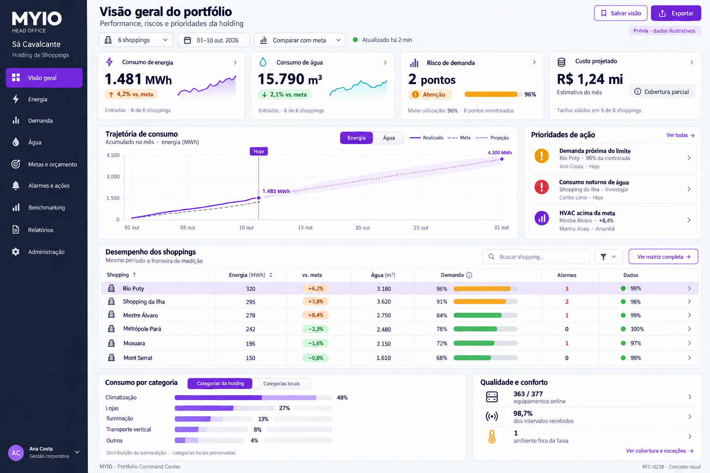
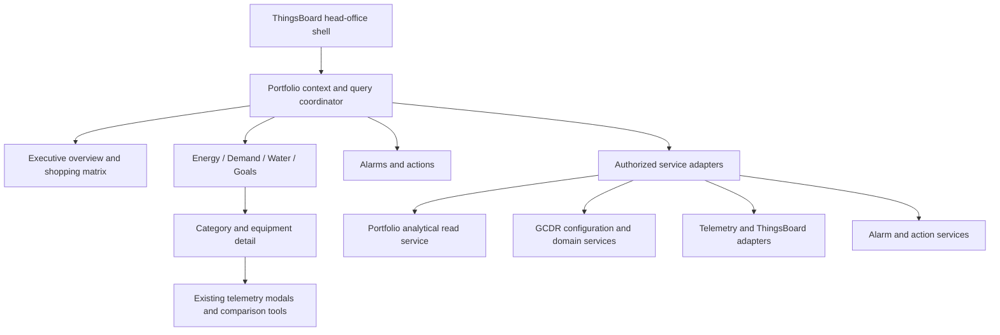

# RFC-0238 — Head Office Portfolio Command Center

- **Feature name:** `head-office-portfolio-command-center`
- **Created:** 2026-10-10
- **Status:** Proposed — product vision, experience specification, and implementation boundaries; no production behavior is implied.
- **Target:** `src/thingsboard/MYIO-SIM/v5.4.0_UNIQUE/` and reusable `myio-js-library` components.
- **Audience:** holding executives, portfolio energy managers, engineering and maintenance leaders, shopping managers, sustainability teams, and MYIO support.
- **Document language:** English. Default product locale: Brazilian Portuguese (`pt-BR`), with localized labels and units.
- **Baseline:** current controller/template/styles/settings and the supplied `logs/screenshot-home-head-office.png` screenshot, inspected on 2026-10-10. Runtime API availability and production permissions were not verified.

## Visual preview

The following image is an AI-generated design concept with illustrative data, not a screenshot of a deployed implementation. It visualizes the executive overview specified in this RFC. Generated with the built-in imagegen tool; the [generation prompt](./RFC-0238-Head-Office-Portfolio-Command-Center-preview-prompt.txt) is preserved for reference.



## 1. Summary

Build a premium head-office workspace that lets a shopping-center holding understand its portfolio, prioritize interventions, and follow results from the portfolio level down to a single meter.

The opening screen must answer five questions within one minute:

1. Are energy, water, and operating costs on track for the selected period?
2. Which shoppings need attention, and what evidence explains their position?
3. Which supply points are approaching contracted demand, and which contracts deserve review?
4. Which equipment categories explain the changes in consumption?
5. What action should happen next, who owns it, and when is it due?

The proposed experience combines an executive overview, a portfolio comparison matrix, dedicated analytical workspaces, and an action queue. The existing device grid remains the detailed equipment workspace, reached through context-preserving drill-downs.

Each shopping retains its own equipment categories. A separate, versioned holding taxonomy makes cross-shopping comparisons possible without forcing every shopping into an identical operational structure.

“Premium” means clear hierarchy, trustworthy numbers, fast navigation, and polished interaction. Every chart has a decision to support and a path to the underlying evidence.

## 2. Current experience and reusable foundations

### 2.1 What the screenshot establishes

The supplied screen presents a holding logo, equipment connectivity, energy consumption, mean temperature, and water consumption across a top row. A second row contains the domain/context selector, shopping filter, period, load/reset actions, and Goals entry. The content is a large equipment card grid with shopping badges, consumption, power, selection, and a comparison footer.

This is useful for finding a chiller, opening its telemetry, and comparing selected equipment. It gives most of the screen to individual assets before establishing portfolio performance or priorities.

Specific opportunities visible in the screenshot:

- The header energy value (`1,481 GWh`) and equipment-context value (`590,313 MWh`) have different apparent scopes. The screenshot alone does not establish a calculation defect; it establishes the need for explicit scope labels and a reconciliation path.
- Connectivity appears in both the top row and grid summary. The new home should use that space for goal deviation, demand exposure, or unresolved actions while keeping connectivity accessible as a data-quality indicator.
- Equipment cards show consumption and power, but the distinction between period totals and the timestamp of a latest reading deserves stronger treatment.
- Mean temperature can hide localized discomfort. Head office needs exceptions, affected zones, and measurement coverage alongside any mean.
- Goals and comparisons already exist, but the opening experience does not bring their conclusions into a shopping-level decision table.

### 2.2 Evidence in the current code

| Current foundation | Evidence | Proposed use |
|---|---|---|
| Unified shell and component lifecycle | `v5.4.0_UNIQUE/template.html`: header, menu, telemetry grid, footer, modal host | Introduce a page host and persistent context bar; preserve legacy entry points during rollout |
| Reusable components | Controller calls `createHeaderComponent`, `createMenuComponent`, `createTelemetryGridComponent`, and `createFooterComponent` | Reuse device investigation and comparison capabilities |
| Energy and water panels | `createEnergyPanelComponent`, `createWaterPanelComponent` | Reuse applicable charts through adapters; extend their models for portfolio/category semantics |
| Goals and shopping comparisons | `openGoalsForCustomer`, `openGoalsCompare`, `CustomerGoalsCard` | Promote goal performance into the home and dedicated Goals workspace |
| Financial foundations | `src/components/financial-goals/`: coverage, budget, money types, rollout gate | Preserve quantity/money separation, decimal amounts, and partial-coverage behavior |
| Alarm management | `createAlarmsNotificationsPanelComponent` integration | Reuse alarm evidence and supported lifecycle operations |
| Category calculations | `buildEnergyCategoryData`, `buildWaterCategoryData`; library classification helpers | Adapt existing classifications into explicit local and holding category identities |
| Fixed category assumptions | `EnergySummaryData.byCategory` and `DistributionMode` in `energy-panel/types.ts` | Add a dynamic category model rather than expanding a fixed union for every shopping |
| Water residual calculation | `buildWaterCategoryData` currently clamps its residual with `Math.max(0, ...)` | Introduce a signed, quality-qualified balance for the new analytical workspace |

The inspected controller is approximately 12,000 lines. The new work should extract focused components and adapters instead of adding another large inline page implementation. Existing financial modules are present in code; their presence does not establish customer eligibility or backend deployment status.

### 2.3 Related local RFCs

- [RFC-0111 — Unified Main Single Datasource Architecture](./RFC-0111-Unified-Main-Single-Datasource-Architecture.md).
- [RFC-0121 — TelemetryGrid](./RFC-0121-TelemetryGridComponent.md).
- [RFC-0128 — Equipment categorization](./RFC-0128-MainDeviceSetupCategory.md).
- [RFC-0207 — Customer-scoped classification profiles](./RFC-0207-CustomerScopedDeviceClassificationProfile.md).
- [RFC-0217 — CustomerGoalsCard small multiples](./RFC-0217-CustomerGoalsCard-SmallMultiples.md).
- [RFC-0228 — Financial goals and rollout](./RFC-0228-Financial-Goals-Gap-and-Rollout-Index.md).
- [RFC-0234 — Transformer exclusions and double-counting](./RFC-0234-Energy-Transformadores-Group.md).
- [RFC-0178 — Alarm integration](./RFC-0178-AlarmHeaderFilterIntegration.md).

External GCDR contracts referenced by those documents must be qualified as GCDR RFCs. Their numbers must not be confused with local library RFC numbers.

## 3. Product scope and user journeys

### 3.1 Primary journeys

| User | Starting question | Expected journey | Useful outcome |
|---|---|---|---|
| Holding director | Which properties are off plan? | Overview → portfolio matrix → shopping summary | Three concrete priorities with accountable owners |
| Portfolio energy manager | Where is demand exposure or avoidable capacity? | Demand → supply point → contract and interval history → scenario | Evidence-backed contract review or operating recommendation |
| Engineering manager | What changed in HVAC consumption? | Energy → holding category → comparable shoppings → local equipment | Identified contributor and investigation task |
| Water manager | Where is unexpected overnight consumption? | Water → exception → balance and interval profile → meter | Investigated event with evidence and follow-up |
| Shopping manager | What does head office need from my team? | My shopping → action queue → linked alarm/goal | Clear assignment and progress updates |
| Finance/sustainability analyst | Are improvements measurable? | Goals → actual versus baseline → normalized comparison → report | Reproducible results with scope and coverage disclosed |

Example: the director opens the current month, sees two demand warnings and one water anomaly, selects a shopping, and finds that its energy deviation is concentrated in HVAC. The energy manager opens that category, compares operating schedules and outdoor conditions where available, and assigns an investigation. The following review shows the action status and observed consumption change without automatically claiming causality or verified savings.

### 3.2 Goals

- A coherent portfolio → shopping → supply point/category → equipment hierarchy.
- Contracted demand management separated from energy volume and instantaneous power.
- Dynamic local categories with comparable holding rollups.
- Energy and water accounting that explains coverage and avoids overlapping meters.
- Goals, forecasts, operational alarms, and actions connected in a single workflow.
- Consistent filters, units, freshness, exports, access control, and historical reproducibility.
- Incremental adoption of existing components and integrations.

### 3.3 Non-goals for the first release

- Automatic equipment switching, load shedding, or changes to utility contracts.
- A universal utility-billing engine or a promise that estimated cost equals the invoice.
- Automatic classification based only on equipment names.
- A replacement for all ThingsBoard dashboards or the existing alarm backend.
- AI-generated conclusions without linked measurements, assumptions, and quality checks.
- Treating an executive design specification as confirmation that new backend APIs already exist.

## 4. Information architecture

Use a persistent navigation rail with nine destinations. Each destination has a stable deep link and preserves authorized shopping selection and period.

| Destination | Main question | Primary content |
|---|---|---|
| **Overview** | Where should the holding act? | Executive KPIs, portfolio matrix, trend, priorities |
| **Energy** | What drives energy use? | Metering boundary, consumption trends, category contributions, equipment |
| **Demand** | Are supply contracts and measured demand aligned? | Contract register, interval demand, headroom, scenarios |
| **Water** | Is water use controlled and explained? | Supply/consumption balance, category use, night flow, exceptions |
| **Goals & Budget** | Are actuals and projections on plan? | Quantity goals, financial budgets, forecasts, revisions |
| **Alarms & Actions** | What requires intervention? | Active alarm inbox, assignments, SLA, investigation history |
| **Benchmarking** | Which properties are comparable? | Peer groups, normalized indicators, heatmaps, comparisons |
| **Reports** | Can this analysis be shared and reproduced? | Exports, report jobs, saved snapshots; schedules in a later phase |
| **Administration** | What makes the analysis trustworthy? | Categories, contracts, metering topology, goals, mappings, permissions |

Temperature and comfort appear as cross-cutting operational evidence and in shopping detail. A dedicated comfort workspace can be added when sensor coverage and user demand justify it.

### 4.1 Global context

A compact sticky bar contains holding identity, shopping/region selector, period, comparison baseline, display timezone, refresh state, and saved view. Advanced filters include accounting scope, supply point, category, and data-quality eligibility.

- Default home period: month to date, explicitly labeled as partial.
- Comparison options: corresponding elapsed period last year, previous equivalent period, and approved goal to date.
- Presets and custom intervals use `[start, end)` with explicit timezone conversion.
- Multi-shopping analysis declares whether it uses a shared UTC interval or local business dates. Billing and operating-day views use each shopping's configured local calendar.
- Global filters apply to every applicable analytical card. Non-applicable filters remain visible as inactive chips with an explanation; changing to Demand must not silently treat an equipment category as a contract filter.
- Draft filter changes apply together. Responses from an older selection never overwrite the current context.
- Live operational widgets display their own “Live now” label when the analytical period is historical.
- Saved views persist filters and layout, never credentials or permission grants. URLs use stable IDs and recheck authorization.

## 5. The opening screen

### 5.1 Desktop composition

At a 1440-pixel viewport, use a 224-pixel navigation rail, a 64-pixel utility header, and a 12-column content grid with 24-pixel gutters. The home has a deliberate vertical order; the portfolio matrix may continue below the fold. Do not compress every module into one screen.

```text
┌───────────────┬─────────────────────────────────────────────────────────────┐
│ Holding       │ Portfolio overview     [Saved view] [Share] [Export]       │
│               │ [Shoppings] [Month to date] [vs goal]  Updated 2 min ago    │
│ Overview      ├─────────────────────────────────────────────────────────────┤
│ Energy        │ Energy       Water        Demand risk      Cost outlook    │
│ Demand        │ Actual/goal  Actual/goal  Exposed points   Estimate/coverage│
│ Water         ├───────────────────────────────────┬─────────────────────────┤
│ Goals         │ Portfolio trajectory              │ Priority actions        │
│ Alarms        │ Actual · goal · forecast          │ Evidence · owner · due  │
│ Benchmarking  │ Energy / Water                    │ Open investigation      │
│ Reports       ├───────────────────────────────────┴─────────────────────────┤
│ Administration│ Shopping performance matrix                                 │
│               │ Shopping | Energy | Water | Demand | Goals | Alarms | Data  │
│               ├───────────────────────────────────┬─────────────────────────┤
│               │ Consumption drivers               │ Coverage and comfort    │
│               │ Category deltas / ranked bars     │ Exceptions / freshness  │
└───────────────┴───────────────────────────────────┴─────────────────────────┘
```

### 5.2 Executive KPI cards

Use four primary cards. Each contains an actual value, a comparison with a named denominator, a sparkline where meaningful, scope, and coverage. Entire cards have an accessible drill-down action.

| Card | Main value | Supporting context | Click destination |
|---|---|---|---|
| Energy | Period kWh/MWh at the selected accounting boundary | Variance versus goal to date, forecast, covered shoppings | Energy with identical scope |
| Water | Period m³ at the selected supply/consumption boundary | Variance versus goal, candidate anomalies, coverage | Water |
| Demand exposure | Count of eligible supply points above configured warning level | Worst utilization, contract/data coverage, actual or projected label | Demand sorted by exposure |
| Cost outlook | Eligible projected amount in BRL | Native budget comparison only with sufficient coverage; included charge components | Goals & Budget |

If cost is unavailable, render an informative configuration/coverage state of the same size. Do not substitute zero or an invented estimate. Demand exposure is not the sum of instantaneous equipment power divided by all contracts.

### 5.3 Portfolio trajectory

A wide chart switches between energy and water. It shows actual cumulative consumption, approved goal to the same timestamp, and a visually distinct forecast with uncertainty information when a supported method provides it. A second mode shows period buckets for detecting weekday and overnight behavior.

Hover/focus shows actual, goal, deviation, covered intervals, and whether the bucket is complete. Selecting a range updates a temporary investigation scope with an explicit Apply action. No energy/water dual-axis chart is needed.

### 5.4 Shopping performance matrix

This is the main executive comparison surface, with pinned shopping names and a configurable compact column set:

- Shopping, region, and operational owner.
- Energy actual, goal deviation, and forecast deviation.
- Water actual and goal deviation.
- Highest relevant supply-point demand utilization and number of exposed points.
- Eligible monetary projection and budget status.
- Unresolved critical alarms, overdue actions, and data coverage/freshness.

Default sorting places unresolved critical conditions first, then configured demand risk, then largest comparable goal deviation. The ordering rules are visible; avoid an unexplained composite “health score.” Missing/insufficient data is a distinct status, never green.

Every cell opens its corresponding evidence. The shopping name opens a summary drawer with trend, top drivers, supply points, category availability, and actions. “Open shopping workspace” provides a full-page investigation route. The user's table sorting and scroll position survive returning from detail.

### 5.5 Priority actions and insight cards

Show at most five prioritized items initially. Each item includes shopping, reason, affected asset/supply point, observed interval, quality, owner, due date, and next action.

Examples are “Review rising HVAC consumption,” “Investigate sustained overnight water use,” and “Review demand contract approaching renewal.” Insights start from documented deterministic rules. An anomaly is a candidate for investigation, not proof of a leak or equipment fault.

“Why this appears” exposes the rule, baseline, thresholds, and evidence. Dismissal requires a reason when the item is part of an operational workflow. Assigned work is not marked complete merely because its source alarm closes.

## 6. Premium visual and interaction language

The visual identity should feel like an enterprise analysis workspace with strong MYIO/holding branding:

| Element | Proposed specification |
|---|---|
| Canvas | Light neutral `#F5F7FB`; dark alternative `#101827` |
| Surfaces | White / dark slate, subtle borders; restrained shadows |
| Brand | MYIO purple `#6D28D9` for navigation and primary actions; holding logo and a configurable accent |
| Typography | Nunito for continuity; tabular numerals; clear 12/14/16/24/32 px hierarchy |
| Geometry | 12–16 px card radii, 8 px spacing scale, consistent panel headers |
| Charts | Stable category colors by canonical ID; gridlines subdued; actual solid, goal dashed, forecast explicitly distinct |
| Status | Text and icon plus color; warning and critical colors reserved for meaningful states |
| Motion | Brief 120–180 ms transitions, no layout shifts or continuously animated KPI counters; reduced-motion support |
| Density | Comfortable and compact table modes; equipment card mode remains optional |

Use ranked bars, small multiples, bullet charts, interval heatmaps, and readable tables. Use a topology diagram only when topology is known. A map is optional for geography-based work; it must not displace the performance matrix. Avoid 3D charts, decorative gauges, and large donut charts for many categories.

At 1024 px, collapse the rail and stack priority actions below the trend. At 768 px, use two KPI columns and an explicit table-column chooser. At 390 px, use single-column summaries and full-screen detail panels; keep critical actions available without horizontal page scrolling. Tables may scroll within their own labeled region.

Keyboard navigation, visible focus, readable contrast, accessible chart summaries/data tables, non-color status cues, focus restoration, and a sensible screen-reader reading order are acceptance requirements. “Live” updates should not repeatedly announce every numeric change.

## 7. Energy: categories that respect each shopping

### 7.1 Three independent dimensions

Do not overload one category field with unrelated business meanings:

1. **Accounting role/topology:** utility supply, tenant submeter, equipment submeter, generation, export, or virtual balance.
2. **Operational category:** what the equipment does, such as HVAC, vertical transport, lighting, or hydraulic pumping.
3. **Tariff category:** the explicit classification used by the pricing API, such as its existing `COMMON_AREA`/`SPECIFIC` model.

A local equipment category does not automatically determine its tariff or whether its reading belongs in the portfolio total.

### 7.2 Local taxonomy and holding taxonomy

Each shopping has a versioned local tree with stable category IDs, parent IDs, labels, domain, and effective dates. The holding defines a smaller comparable taxonomy. Mapping is explicit and reviewable.

| Shopping | Local path | Holding path | Comparison behavior |
|---|---|---|---|
| A | CAG / Chillers | HVAC / Cooling production | Comparable with equivalent cooling-production meters |
| B | Air conditioning / Water-cooled plant | HVAC / Cooling production | Same holding rollup, local wording retained |
| C | Split units | HVAC / Local cooling | Included in HVAC total; separate leaf benchmark |
| A | Escalators | Vertical transport / Escalators | Included where this equipment exists |
| B | Irrigation pumps | Water systems / Pumping | Never inferred as HVAC from a generic “pump” name |
| C | Specialty equipment | Unmapped local category | Visible in local analysis and mapping backlog |

Rules:

- A device has one primary additive operational leaf per domain/effective interval. Optional tags support overlapping searches, but tag totals are explicitly non-additive.
- Multiple local categories may map to one holding node. A local category must not fan out into multiple additive holding nodes without an explicit allocation model; allocated metering is deferred from the first release.
- Split ambiguous local categories before claiming comparable leaf-level benchmarks.
- Missing category, not applicable, unmetered category, and measured zero are distinct states.
- Devices assigned only to a broad parent use an explicit “unspecified within category” leaf; parent and child totals are not added together.
- Mapping revisions carry author, reason, version, and effective date. Historical exports retain the version used; a deliberate restatement produces a new analysis version.
- Categories are keyed by customer and stable ID, never by label or array position.
- Changing categories previews affected devices, totals, goals, and comparisons before publishing. Concurrent edits use version checks.

Reuse RFC-0207 resolution where applicable, but do not assume one global active customer profile is safe for a multi-shopping session. The head-office adapter must resolve/cache classifications by customer and profile version.

### 7.3 Energy workspace layout

Top: energy actual, goal deviation, normalized intensity, out-of-hours use, and quality. Main chart: interval consumption or cumulative actual/goal. Below it:

- **Category contribution:** ranked bars by holding category, with change in kWh and contribution to total deviation.
- **Shopping × category heatmap:** absolute volume, share, or normalized indicator, each with its own labeled mode.
- **Category small multiples:** compare eligible shoppings with a common scale by default and an explicit independent-scale option.
- **Equipment table/grid:** local category, shopping, consumption, measured peak, reading freshness, status, and actions.

The category selector can switch between “Holding categories” and “Local categories.” When several shoppings are selected, local categories are grouped under their shopping and never merged solely by label.

Comparisons show period, accounting boundary, operating hours, coverage, and relevant equipment characteristics. Cooling-production efficiency indicators such as kWh per cooling-output unit are available only with the required output measurement; electric consumption alone does not establish equipment efficiency.

### 7.4 Metering boundaries and reconciliation

The energy home defaults to a validated supply boundary for each shopping. Equipment totals are a breakdown/investigation view, not an additional component added to supply energy.

- Model metering as a validated graph with meter roles, containment, effective intervals, and exclusion rules.
- Select a non-overlapping set of meters for each additive total; retain existing `excludeGroupsTotals` semantics through an explicit adapter.
- Keep grid import, onsite generation, export, and estimated site consumption separate. Compute a site balance only when the configured topology supports it, including storage effects where relevant.
- Display residuals with their sign, time alignment, and uncertainty. A negative balance indicates a reconciliation problem or a modeled flow requiring explanation; never silently clamp it to zero.
- Changes in tenant coverage, meter replacement, resets, and duplicated ingestion streams produce quality flags and versioned corrections.

Every total offers “Explain this total”: included meters, excluded meters, accounting role, coverage, period, and reconciliation. This directly addresses the ambiguous header-versus-grid scope in the supplied screenshot.

## 8. Contracted demand management

### 8.1 Manage contracts at supply-point level

A shopping can have multiple utility supply points, each with a meter boundary and a versioned contract. Contracts are not attached indiscriminately to equipment categories or to the holding as one aggregate.

Required contract information:

- Shopping, supply point, trusted meter mapping, utility/customer account reference, and business owner.
- Effective start/end dates, revision history, and source document/reference.
- Contracted capacity in kW for each applicable time band and its calendar/timezone.
- Measurement interval and approved demand calculation method.
- Contract-specific warning thresholds, applicable charging-rule reference/version, and data-quality eligibility.
- Renewal date, notice period if supplied, review status, and responsible person.

Contracted equipment counts in `premium-modals/contract-devices` are a different concept and must not be reused as electrical contracted demand.

### 8.2 Indicators and semantics

| Indicator | Definition | Display rule |
|---|---|---|
| Instantaneous power | Latest valid power reading at the supply boundary | Show timestamp; never label as interval demand |
| Completed-interval demand | Result of the configured interval calculation | Show method, interval, and quality |
| Measured period peak | Maximum eligible completed-interval demand in scope | Include timestamp, contract version, and band |
| Utilization | Eligible measured demand / applicable contracted kW | Undefined for missing/zero contract; do not fabricate a percentage |
| Headroom | Applicable contracted kW minus eligible measured demand | Signed value with matching band and interval |
| Current-interval projection | A supported estimate for the open interval | Explicitly projected; suppress when freshness/coverage is inadequate |
| Underutilization candidate | Configurable persistent utilization pattern over complete comparable periods | Contract-review signal, not a guaranteed saving |

The first supported measurement method must be selected and validated with domain owners. If demand is derived from interval energy, the method is `interval kWh / interval hours` over a complete, correctly aligned interval. If it is derived from power samples, sampling/weighting and gap handling must be specified. A maximum instantaneous sample is not interchangeable with either method.

Do not embed a universal exceedance percentage, tariff penalty, or billing rule in the frontend. These are contract/rule-engine inputs validated by the responsible business team. This RFC specifies product behavior, not jurisdiction-specific billing rules.

### 8.3 Demand workspace

Use a supply-point table with contracted values, measured peaks, utilization bullet charts, projected warning, coverage, contract expiry, and owner. Selecting a row opens:

1. An interval chart with contracted capacity and warning bands.
2. Monthly peak history with contract revisions and seasonal context.
3. Equipment contributions during the selected peak interval, only where aligned non-overlapping submeter data is available.
4. A scenario panel for alternative capacity and supported operating assumptions.
5. An action timeline and supporting contract evidence.

A 12-month review is an initial recommended analysis window, not a universal contract rule. Insufficient history is explicit. Scenario results list assumptions, tariff-rule version, included cost components, coverage, and uncertainty. Users can save a proposed review; applying an actual contract change requires a separate authorized workflow.

At holding level, show exposed supply-point counts and individual headroom. A sum of contracted capacity can be shown as a labeled inventory value. A simultaneous portfolio load curve requires aligned timestamps; never present the sum of each shopping's individual peak as a simultaneous holding peak or use it to infer shared contractual capacity.

## 9. Water management

The Water workspace separates supplied volume, measured downstream use, operational category distribution, and unexplained balance.

- Sources may include utility supply, wells, delivered water, and reuse, when configured and measured.
- Local categories may include restrooms, cooling towers, food courts, tenants, irrigation, cleaning, and technical systems. Holding mappings follow the same governance as energy.
- Show daily/hourly profiles, night-flow candidates, expected operating schedules, meter connectivity, and cumulative goal performance.
- Tank-level information is context, not automatically a volume flow. A balance may include storage change only with reliable level-to-volume calibration and aligned readings.
- For a configured boundary, `residual = measured inputs - measured outputs - change in stored volume`, with any modeled adjustments explicitly listed. Reuse circulating inside the boundary is not counted again as external input.
- Missing downstream meters produce incomplete reconciliation. Residual water is not automatically leakage; timing, storage, meter calibration, and unmetered consumption must remain visible.
- Show m³/m² and liters/visitor only when area/visitor denominators are available for the same scope and period.

An overnight-use alert opens its interval profile, threshold/baseline, affected meters, and quality flags. The operator can link an existing alarm or create an investigation and record findings. Remote valve actuation is outside this release.

## 10. Goals, financial budgets, and forecasts

Goals become first-class dashboard context rather than an isolated modal. Reuse existing GCDR goals integrations and `CustomerGoalsCard` where their semantics match.

### 10.1 Separate the concepts

- **Quantity goal:** approved kWh or m³ target.
- **Monetary projection:** an estimated financial amount derived from eligible quantities and supported tariffs.
- **Currency budget:** a native financial target in a specified currency.
- **Forecast:** expected end-of-period quantity or amount, with a named method and eligibility.

Preserve the naming bridge in `financial-goals/moneyTypes.ts`. Existing component props named `budget` may mean quantity; adapters must not interpret them as money.

### 10.2 Goal workflow

Support holding → shopping → category → device goals where the underlying API supports that granularity. Otherwise expose the supported level and mark finer allocation as unavailable.

Annual/monthly goals can be phased into operating days/hours by an explicit schedule or approved profile. Display allocated, unallocated, and overallocated quantities when parent/child targets do not reconcile. Never silently force the sum to match.

Proposed workflow: draft → review → approved → superseded, with revisions, effective dates, author, reason, and optimistic concurrency. Backend support for this workflow is a dependency, not an assumption about the current goals API. Historical comparisons identify the goal revision used.

### 10.3 Comparisons and forecasts

```text
quantity variance       = actual - goal for the same elapsed interval
quantity variance %     = (actual - comparable goal) / comparable goal × 100
portfolio intensity     = sum(eligible consumption) / sum(matching denominators)
portfolio goal variance = (sum(comparable actuals) - sum(comparable goals))
                          / sum(comparable goals) × 100
```

A zero/missing denominator yields “Not comparable,” not infinity or zero percent. Aggregate ratios are calculated from eligible totals, not the average of shopping percentages. Properties with missing goals remain visible outside the comparable subtotal, with counts and excluded volume.

For forecasts, start with a documented schedule-aware baseline only after sufficient representative history is available. Weather/occupancy adjustment is a later capability requiring those inputs. Label a simple extrapolation as such. Missing data must not be filled with zero, and a partial month must not be compared with a full-month actual without an explicit mode change.

Money remains decimal strings in the wire/domain model, with backend-authoritative rounding. Show tariff coverage, eligible shoppings, included energy/water/demand components, and exclusions. Existing quantity-goal monetary overlays must not be relabeled as actual utility spend. Demand charges enter cost outlook only when a compatible authoritative calculation exists. Do not combine multiple currencies or compare a partial cost estimate with a full budget to declare success.

## 11. Alarms, actions, and operational accountability

The alarm inbox supports shopping, domain, severity, lifecycle, assignee, age, and SLA filters. It distinguishes device telemetry loss, demand exposure, consumption anomalies, comfort exceptions, and data-quality problems.

Reuse backend-supported alarm acknowledgment, snoozing, escalation, and closure. Unsupported operations must be visibly unavailable rather than simulated as successful.

An **action** is work linked to one or more alarms, goals, meters, or insights. Its proposed lifecycle is open → assigned → in progress → resolved → verified, with cancellation/reopening where appropriate. Actions include owner, due date, comments, attachments/references, evidence, and an audit trail. Identify the authoritative action/ticket service before implementing writes.

Separate technical alarm state from business action state. Deduplicate repeated signals by source identity and condition; related alarms can be grouped without deleting their individual history. SLA clocks, pauses, and business calendars are server-defined.

Notification channels and digests are opt-in/configured. The dashboard must not send email, create external tickets, or trigger control commands merely because an insight is displayed.

Comfort adds context to energy decisions: out-of-range zones, duration, sensor coverage, and operating schedule. Energy reduction accompanied by inadequate comfort is not automatically an efficiency win.

## 12. Benchmarking, reports, and saved analysis

Benchmarking supports absolute volume and comparable normalized indicators: energy/water per area, per operating hour, or per visitor. Denominators are versioned by shopping and effective period. “Area” explicitly names the basis, such as gross leasable area or conditioned area; they are not interchangeable.

Peer groups may use size, operating schedule, climate context, occupancy, and cooling-system type. Availability determines which grouping dimensions can actually be applied. Show cohort membership, excluded properties, and data sufficiency. Do not rank all shoppings as if their business conditions were identical.

The report center supports CSV/data export and a shareable executive report with filters, accounting boundary, units, source timestamps, coverage, category/contract/goal versions, and assumptions. Exports reconcile with the on-screen snapshot. Larger outputs use a backend job with progress, retry/idempotency, cancellation where supported, authorized download, and expiry.

Saved views store query/layout preferences. Report snapshots preserve the data and configuration references needed to reproduce the result. Scheduled reports and external delivery are later phases with explicit permission and recipient controls.

An optional future sustainability module may derive emissions only from approved, versioned factors and a declared accounting method. Neither an emissions card nor “verified savings” should be inferred solely from lower raw consumption.

## 13. Data contract and trust model

### 13.1 Sources of truth

| Concern | Proposed owner | Integration rule |
|---|---|---|
| Device/customer identities and relationships | GCDR and validated TB mappings | Keep TB, GCDR, and ingestion IDs distinct |
| Historical measurements and aggregates | Existing telemetry/data services | Server-side aggregation for portfolio history; preserve units and quality |
| Local classification | Existing configured profile provider through adapters | Customer/version-scoped; no silent replacement by a global default |
| Holding mapping and topology | Proposed versioned configuration service, preferably GCDR | Ownership/API require a companion contract |
| Goals, tariffs, currency budgets | Existing GCDR contracts where deployed | Preserve coverage and rollout gates |
| Demand contracts and scenarios | Proposed GCDR/domain service | Requires a companion RFC and validated calculation method |
| Alarm lifecycle | Existing alarms backend | No frontend-only authoritative state |
| Actions and approvals | Service to be selected | Capability-gated until durable authorized writes exist |
| UI preferences | User-scoped preference store | Preferences never carry authorization |

### 13.2 Minimum analytical response semantics

Each response must identify scope, actual interval, bucket alignment, units, source timestamp, snapshot/query identity, configuration versions, quality, and authorization-filtered coverage. A proposed frontend-normalized metric shape is:

```ts
type MetricState = 'available' | 'partial' | 'unavailable' | 'not-applicable';
type Freshness = 'fresh' | 'stale' | 'unknown';

interface PortfolioMetric {
  key: string;
  state: MetricState;
  value: number | null;       // Quantity metrics only; null is not zero.
  unit: 'kWh' | 'kW' | 'm3' | 'percent' | 'count';
  scope: {
    holdingId: string;
    customerIds: string[];
    accountingBoundaryId: string;
    categoryId?: string;
    supplyPointId?: string;
  };
  period: { start: string; end: string; timezone: string };
  observedAt: string | null;
  computedAt: string;
  freshness: Freshness;
  coverage: {
    eligibleCustomers: number;
    selectedCustomers: number;
    observedIntervals: number;
    expectedIntervals: number;
    method: string;
  };
  reasons: string[];
  snapshotId: string;
  calculationVersion: string;
  configurationVersions: Record<string, string>;
}
```

This is a proposed normalized model, not an existing API guarantee. Money uses the existing separate decimal-string types. Meter coverage, interval coverage, tariff coverage, category mapping coverage, and permission scope are different dimensions; no single green percentage should imply all are complete.

The read service must provide summary, shopping matrix, category rollups, time series, active demand exposure, and capability metadata without requiring the browser to fetch every device's history. Exact endpoint paths, pagination, maximum query size, aggregation rules, and error schemas belong to the backend companion contract.

### 13.3 Quality and empty states

Every module supports loading, available, partial, stale, no data, not configured, not applicable, forbidden, and service unavailable as appropriate. Partial service failure must not blank unrelated modules. Cached values remain visible only with their original scope and a stale label; after a shopping change, the prior customer's values must not masquerade as the new result.

Operational connectivity and data completeness are separate: a connected device may lack valid historical intervals, and an offline device may still have complete data for a past period.

### 13.4 Access control

Server authorization enforces holding/customer scope and permissions for viewing, exporting, editing mappings/contracts/goals, and operating alarms/actions. Frontend capability checks improve the experience but do not authenticate a user or authorize a backend request.

The holding aggregation service must intersect requested shopping IDs with the caller's entitlements and scope caches accordingly. Direct object references, saved views, exports, and report downloads use the same checks. A shared browser API key alone does not establish individual actor identity for audited writes.

## 14. Frontend architecture and integration



Proposed library structure:

```text
src/components/head-office/
  shell/                    navigation, page host, global context
  overview/                 KPI cards, trend, portfolio matrix, priorities
  energy/                   category analysis and metering reconciliation
  demand/                   supply-point table, detail, scenario review
  water/                    balance, profiles, exception evidence
  goals/                    adapters over existing goals/financial components
  operations/               alarm and action integration
  shared/                   metric states, quality, drawers, accessible tables
src/utils/portfolio/
  context.ts                query identity and filter applicability
  taxonomy.ts               local-to-holding mappings and invariants
  comparability.ts           coverage and denominator eligibility
  metricDefinitions.ts      units, aggregation semantics, display metadata
src/services/portfolio/
  ports.ts                  typed read/write capabilities and cancellation
  adapters/                 backend/TB integrations, kept outside DOM code
showcase/head-office-portfolio/
                            deterministic scenarios and responsive preview
```

The widget controller initializes the shell, supplies authorized context/adapters, and disposes the instance. It should not own the calculation engine or generate every workspace through inline HTML strings.

Use a shared query coordinator with request cancellation, query-key deduplication, controlled concurrency, and stale-response guards. Historical views refresh on context changes; live modules poll or subscribe according to backend capabilities, with visible freshness and paused background work where appropriate. The shell, not a destroyed detail modal, owns portfolio badges.

Cache keys include entitlement scope, customers, period/timezone, accounting boundary, categories, granularity, and configuration versions. Keep current snapshot identity across the KPI, matrix, and export. If independently sourced data cannot share a snapshot, disclose their separate timestamps and do not imply transactional consistency.

Preserve `createTelemetryGridComponent`, device modals, comparison selection, alarm components, and applicable goals/financial views through adapters. Update the build/export path for the existing UMD `window.MyIOLibrary` consumer as well as module consumers; a new subpath export alone does not integrate the ThingsBoard widget.

## 15. Performance and resilience budgets

Proposed release targets, to be measured against an agreed browser/network fixture:

- Representative fixture: 50 shoppings and 10,000 registered devices, with lazy device detail; also test the current six-shopping scale.
- First useful overview within 3 seconds at p75 on the agreed reference network; cached context interaction within 300 ms where no network calculation is required.
- Summary payload target below 500 KB compressed; detail lists paginated/virtualized and charts bounded to an appropriate display resolution.
- One coordinated set of summary queries per context, never one historical request per device on initial home load.
- Request concurrency bounded by the adapter policy; no uncontrolled fan-out to every shopping from each card.
- Independent failure states for telemetry, contracts, goals, money, and alarms.
- No growing listeners/timers across repeated navigation; `destroy()` aborts instance-owned requests and removes subscriptions/charts.

These are proposed engineering budgets, not measured claims about the current implementation. Record payload sizes, query counts, long tasks, and time to useful content in the pilot.

## 16. Delivery plan and release gates

| Phase | Deliverable | Gate |
|---|---|---|
| 0 — Product and data contracts | Confirm KPI/accounting definitions, identity, taxonomy mapping, demand method, and backend ownership | Domain owners approve sample calculations and source availability |
| 1 — Visual prototype | Overview, matrix, shopping drawer, category drill-down, demand detail; light/dark and mobile | Users complete the primary journeys on deterministic realistic fixtures |
| 2 — Read-only executive pilot | Real energy/water/goal summaries, quality, matrix, existing equipment drill-down | On-screen totals reconcile with source fixtures and exports; access checks pass |
| 3 — Demand and dynamic categories | Versioned contracts, mapping workflow, interval demand, partial-coverage handling | Companion services available; temporal revisions and calculation fixtures pass |
| 4 — Operational workflows | Assignments, due dates, supported alarm operations, goal/contract review | Durable authorization, audit, concurrency, and recovery verified |
| 5 — Financial/forecast/report expansion | Eligible cost outlook, documented forecasting, asynchronous reports | Coverage gates, download delivery, and reproducibility pass |
| 6 — Broader rollout | Holding-by-holding enablement with monitoring and rollback | Measured pilot targets and adoption criteria met |

Separate feature/capability flags for the shell, demand, holding taxonomy, financial indicators, forecasts, and write workflows. The legacy grid route remains available during migration. Flags change exposure, not authorization.

Migration must inventory actual IDs, classification providers, exclusions, supply meters, and goal granularity per shopping. Unmapped or invalid configurations enter a visible remediation list. Do not silently remap existing customers or rewrite historical exports. Rollback restores the legacy route without deleting configuration history.

## 17. Acceptance criteria

| ID | Scenario and required outcome |
|---|---|
| AC-01 | An executive can identify the highest-priority shopping, its evidence, and assigned owner from the overview without searching the equipment grid. |
| AC-02 | Global shopping/period changes propagate consistently; late responses from an older query never repaint the new context. |
| AC-03 | Header, shopping matrix, category detail, and export reconcile under the same accounting boundary and snapshot. |
| AC-04 | A supply meter plus its equipment submeters does not double-count the portfolio total; exclusions and signed residuals are explainable. |
| AC-05 | Different local categories map into one holding category while retaining local labels; unmapped/not-applicable/no-data/zero remain distinct. |
| AC-06 | Switching between customer-specific classification profiles cannot contaminate another shopping's results; revisions preserve historical meaning. |
| AC-07 | A shopping with two supply points and multiple effective contract bands shows demand against the correct contract for each interval. |
| AC-08 | Instantaneous power, completed-interval demand, and current-interval projection have distinct labels, timestamps, and eligibility. |
| AC-09 | Missing/zero contract capacity or incomplete interval data yields unavailable utilization, not a false safe state. |
| AC-10 | Individual shopping peaks are not summed and labeled as a simultaneous portfolio peak. |
| AC-11 | Water reconciliation preserves negative residuals and incomplete storage/meter coverage; anomalies are not presented as proven leaks. |
| AC-12 | Month-to-date actuals compare with the matching elapsed goal/baseline; leap dates, timezone boundaries, and partial buckets have deterministic fixtures. |
| AC-13 | Portfolio percentages/intensities use matching eligible totals and denominators; missing goals/area/visitor data remain disclosed. |
| AC-14 | Financial values preserve decimal semantics; incomplete tariff/quantity coverage suppresses definitive budget verdicts. |
| AC-15 | An alarm's closure does not silently complete its linked action; action assignment and edits enforce server permissions and retain audit history. |
| AC-16 | Direct links, cached data, exports, and downloads cannot expose a shopping outside the caller's authorized scope. |
| AC-17 | Keyboard users can navigate filters, matrix cells, drawers, and actions; charts have equivalent readable data and status is not color-only. |
| AC-18 | The overview works at 1440, 1024, 768, and 390 px in both themes with no clipped critical actions or horizontal page overflow. |
| AC-19 | Service outage in one domain produces an isolated, truthful state while other domains remain usable; stale data keeps its source timestamp. |
| AC-20 | Repeated navigation and destruction leave no accumulated timers/listeners; cancelling a request does not imply cancellation of backend work. |
| AC-21 | Scenario outputs and forecasts identify method, assumptions, versions, and unsupported inputs; speculative savings are never marked verified. |
| AC-22 | The reference scale meets the agreed payload/query/render budgets, and the existing device comparison journey continues to work. |

The showcase must include deliberately different shopping taxonomies, a missing category, partial tariffs, an offline supply meter, duplicate/overlapping meters, a contract revision inside the selected period, zero goals, a negative water balance, and denied permissions. Use fixed clocks and deterministic inputs rather than random values for acceptance scenarios.

## 18. Success measures and decisions to close

Pilot measures should be established before broad rollout:

- Median time to identify and explain a portfolio exception; initial target: under 60 seconds in the primary executive journey.
- Time from identifying an exception to assigning an accountable action.
- Percentage of selected shoppings with valid supply boundaries, approved category mappings, goals, and demand contracts, reported separately.
- Agreement between dashboard and exported/reference totals, with no unexplained discrepancies in release fixtures.
- Weekly use by holding managers and shopping operators, and completion of assigned investigations.
- Performance/error rates and the proportion of views shown with stale or partial data.

Reduction in consumption, demand exposure, or cost is a business outcome to measure against an approved comparable baseline. It must not be attributed to the dashboard from a simple before/after total alone.

| Decision | Proposed direction | Owner / blocks |
|---|---|---|
| Portfolio accounting boundary | Supply-point totals for overview; explicit downstream detail | Energy/water domain owners / real-data pilot |
| Demand measurement and charging rules | Versioned supply-point method and contract-specific rule reference | Energy specialist + backend / Demand release |
| Holding taxonomy governance | Small common tree with explicit local mapping and historical versions | Holding operations + product / comparable category rollups |
| Configuration storage | Reuse existing profile adapters; new holding mapping/topology service with one authoritative owner | Architecture + GCDR / configuration writes |
| Action and approval service | Reuse a supported durable service or define a companion contract | Operations + backend / write workflows |
| Monetary coverage | Preserve current eligibility/coverage gates; include only supported components | Finance + GCDR / cost outlook |
| Benchmark denominators | Versioned area basis, operating schedules, visitor inputs where available | Holding data owner / normalized ranking |
| Pilot scope | Start with shoppings that deliberately have different taxonomies and metering maturity | Product + holding sponsor / phased rollout |

The intended end state is a head-office workspace in which every headline number can be explained, every comparison has a valid scope, and every operational priority can become accountable work.
